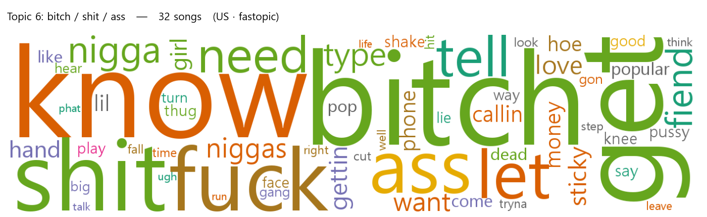
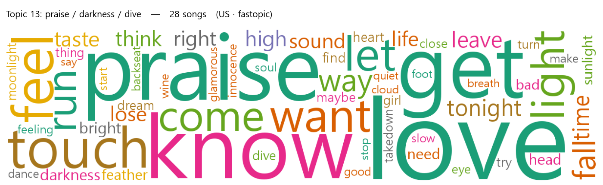
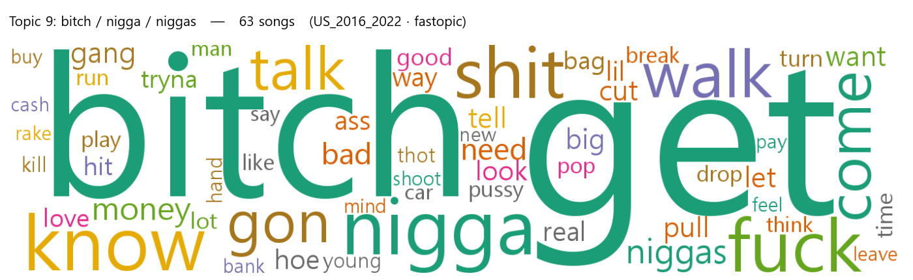

# Lyrics Topic Modeling — What Do Popular Songs Talk About?

**English** | [Türkçe](#türkçe)

Topic modeling on the lyrics of the most-streamed songs in the US and the UK (2016–2025), tracing how the themes of popular music changed across a decade — and how topic-modeling technology itself changed along the way, from LDA (2003) to FASTopic (2024).

> Started as a Text Mining course project at Kocaeli University (2022, hand-written on Google Colab). Revisited in 2026 as a fully reproducible pipeline.

## Repository at a Glance

```
notebooks/, results/     v1 — the original 2022 study (frozen, hand-written)
v2/                      v2 — reproducible package: src, tests, results
  src/lyrics_v2/         charts | collect | clean | model | evaluate | compare
  results/               FINDINGS.md, eval/, models/, compare/, wordclouds/
scripts/                 Spotify track-list collector (run by the data owner)
data/                    git-ignored: lyrics never leave the machine
```

Two versions, one question:

- **v1 (2022, hand-written):** Four topic models compared on 2016–2022 US/UK chart lyrics, evaluated by eye. Kept frozen as a historical artifact.
- **v2 (2026):** Five model generations on freshly collected 2016–2025 data, with quantitative evaluation (`c_v` coherence, topic diversity, `k = 5..40` scans), `topics_over_time`, automated topic labels and unit tests.

## The Models

| Model | Year | Family | In one sentence |
|---|---|---|---|
| **LDA** | 2003 | Probabilistic (bag-of-words) | Classic generative model: documents are mixtures of word-distribution topics. |
| **NMF** | ~2003 | Matrix factorization | Decomposes the TF-IDF matrix into non-negative topic factors. |
| **Top2Vec** | 2020 | Embedding + clustering | doc2vec embeddings → UMAP → HDBSCAN; finds the topic count itself. |
| **BERTopic** | 2022 | Transformer embedding + c-TF-IDF | `all-MiniLM-L6-v2` sentence embeddings, HDBSCAN clusters, class-based TF-IDF keywords; supports `topics_over_time`. |
| **FASTopic** | 2024 | Neural (optimal transport) | Aligns document, topic and word embeddings via dual semantic-relation reconstruction. |

## v2 Results (measured)

Corpora: **US 2016–2022** (565 songs, Billboard Hot 100 year-end + LRCLIB), **US 2023–2025** (369 songs), **GB 2023–2025** (400 songs). Higher is better for both metrics; diversity 1.0 = zero word overlap between topics.

| Model | US 2016–2022 c_v (Div) | US 2023–2025 c_v (Div) | GB 2023–2025 c_v (Div) |
|---|---|---|---|
| LDA (k=15) | 0.4003 (0.55) | 0.3560 (0.50) | 0.3529 (0.57) |
| NMF (k=15) | 0.4234 (0.67) | 0.3880 (0.63) | 0.4314 (0.66) |
| Top2Vec | 0.4759 (1.00, 2 topics) | **0.4224** (1.00, 2 topics) | 0.3521 (1.00, 5 topics) |
| BERTopic | 0.3728 (0.73, 9 topics) | 0.3736 (0.71, 7 topics) | 0.3607 (0.73, 6 topics) |
| **FASTopic** (k=15) | **0.4862** (**1.00**) | 0.4159 (**1.00**) | **0.4500** (**1.00**) |

### Key findings — full analysis in [`v2/results/FINDINGS.md`](v2/results/FINDINGS.md)

1. **The newest model wins.** FASTopic (2024) gets the best coherence in two of three slices and perfect topic diversity in all of them; LDA (2003) is consistently last. The 21-year gap is visible in the numbers.
2. **v1's hand-picked `k=30` was wrong.** The 2022 study fixed `num_topics=30` without justification. The v2 `k = 5..40` coherence scan shows LDA peaking at `k=10` on the same-size corpus (0.409 vs 0.362 at k=30) — a measured correction of our own past choice.
3. **BERTopic's outlier trade-off.** HDBSCAN initially left 35–42% of songs unassigned; `reduce_outliers` brings that to 0% at the cost of a small coherence drop — both numbers reported, not hidden.
4. **The decade shift is largely a genre shift.** Comparing US 2016–2022 vs 2023–2025, hip-hop/street vocabulary falls (`get −6.4`, `money −2.2` per 1 000 tokens) while relationship/introspective words rise (`think +2.9`, `love +1.2`). A lexical genre proxy shows hip-hop share dropping from ~51% (2018) to ~26% (2025) — so "lyrics got softer" is mostly "charts got less rap", and the README says so instead of claiming a mood shift.
5. **US vs UK (2023–2025).** The biggest UK cluster is *love / hard / hold* (36% of songs); the biggest US cluster is the explicit one (26%). One more curiosity: the Korean word **아파트** (from *APT.* by Rosé & Bruno Mars) was dominant enough to become a topic keyword in both markets.

### Visuals

A taste of the best-scoring model (**FASTopic**) — the two faces of the 2023–2025 US charts, and the biggest topic of a decade earlier:







- One banner image **per topic** (v1 style), top 5 topics of every model and slice: [`v2/results/wordclouds/`](v2/results/wordclouds/) — one folder per model/slice.
- Topic evolution 2016–2025, model comparison chart, era word clouds: [`v2/results/compare/`](v2/results/compare/)
- Coherence curves for the k-scan: [`v2/results/eval/`](v2/results/eval/)

### Running v2

```powershell
python -m venv .venv
.venv\Scripts\python -m pip install -r v2/requirements.txt
$env:PYTHONPATH = "v2\src"

.venv\Scripts\python -m lyrics_v2.collect --market US     # lyrics via LRCLIB
.venv\Scripts\python -m lyrics_v2.clean   --market US
.venv\Scripts\python -m lyrics_v2.model   --market US GB
.venv\Scripts\python -m lyrics_v2.evaluate --market US GB --scan-k
.venv\Scripts\python -m lyrics_v2.compare
.venv\Scripts\python -m pytest v2                          # 38 tests
```

Track lists come from Billboard Hot 100 year-end charts (`lyrics_v2.charts`, no API key) and optionally from Spotify search (`scripts/collect_tracks.py`, your own credentials). Lyrics are fetched from the **LRCLIB** public API — no token required.

### Limitations

- **Copyrighted data stays local:** no lyrics, track CSVs or fitted models are committed (`data/` is git-ignored). To rebuild the corpus, see [Running v2](#running-v2).
- **Sampling difference:** 2016–2022 uses Billboard year-end charts; 2023–2025 uses Spotify search ranking — not the same popularity measure.
- **No real genre labels:** genre confounding is measured with a transparent lexical proxy, not metadata.
- **Small corpora:** 369–565 docs per slice; Top2Vec collapses to 2–5 coarse topics and BERTopic needs outlier reduction at this scale.

## v1 (2022) — The Original Hand-Written Study

Kept unchanged in [`notebooks/`](notebooks/) and [`results/`](results/) as the honest "before" picture.

- **Pipeline:** Spotify search (spotipy) for track lists → Genius pages scraped with `requests` + BeautifulSoup → manual cleaning → LDA, NMF, Top2Vec and BERTopic, compared visually by word clouds.
- **Qualitative findings (2016–2019 vs 2020–2022):** pandemic-era UK lyrics surfaced *home / day / life* vocabulary; UK leaned melancholic (*alone, memories, rain*) while the US kept a harder, explicit register; the four models largely confirmed each other.
- **Known flaws, fixed in v2:** lines were joined without spaces (producing glued words like *awayand*), `num_topics=30` was fixed arbitrarily, an unnecessary train/test split was used, and there was no quantitative metric.

## License

MIT — see [LICENSE](LICENSE). The license covers the code only; lyrics and chart data remain the property of their respective owners.

---

<a name="türkçe"></a>

# Şarkı Sözlerinde Konu Modelleme — Popüler Müzik Ne Anlatıyor?

[English](#lyrics-topic-modeling--what-do-popular-songs-talk-about) | **Türkçe**

ABD ve Birleşik Krallık listelerinde en çok dinlenen şarkıların sözleri üzerinde konu modelleme (2016–2025): popüler müziğin temaları on yılda nasıl değişti — ve aynı on yılda konu modelleme teknolojisi LDA'dan (2003) FASTopic'e (2024) nasıl evrildi?

> Kocaeli Üniversitesi Metin Madenciliği dersi projesi olarak başladı (2022, Google Colab'da elle yazıldı). 2026'da uçtan uca yeniden üretilebilir bir pipeline olarak yeniden ele alındı.

## Depoya Bakış

```
notebooks/, results/     v1 — 2022'deki orijinal çalışma (dondurulmuş, el yazımı)
v2/                      v2 — yeniden üretilebilir paket: kod, testler, sonuçlar
  src/lyrics_v2/         charts | collect | clean | model | evaluate | compare
  results/               FINDINGS.md, eval/, models/, compare/, wordclouds/
scripts/                 Spotify liste toplayıcı (veri sahibi çalıştırır)
data/                    git dışı: şarkı sözleri makineden çıkmaz
```

İki sürüm, tek soru:

- **v1 (2022, el yazımı):** 2016–2022 ABD/BK listelerinde dört konu modeli, gözle kıyaslandı. Tarihî kayıt olarak donduruldu.
- **v2 (2026):** Taze toplanan 2016–2025 verisi üzerinde beş model kuşağı; nicel değerlendirme (`c_v` coherence, topic diversity, `k = 5..40` taraması), `topics_over_time`, otomatik konu etiketleri ve birim testleri.

## Modeller

| Model | Yıl | Aile | Tek cümleyle |
|---|---|---|---|
| **LDA** | 2003 | Olasılıksal (bag-of-words) | Klasik üretici model: belgeler, kelime dağılımı olan konuların karışımıdır. |
| **NMF** | ~2003 | Matris ayrıştırma | TF-IDF matrisini negatif olmayan konu çarpanlarına ayırır. |
| **Top2Vec** | 2020 | Gömme + kümeleme | doc2vec → UMAP → HDBSCAN; konu sayısını kendisi bulur. |
| **BERTopic** | 2022 | Transformer gömme + c-TF-IDF | `all-MiniLM-L6-v2` cümle gömüleri, HDBSCAN kümeleri, sınıf bazlı TF-IDF anahtar kelimeleri; `topics_over_time` desteği. |
| **FASTopic** | 2024 | Nöral (optimal transport) | Belge, konu ve kelime gömülerini ikili anlamsal ilişki yeniden kurulumuyla hizalar. |

## v2 Sonuçları (ölçülmüş)

Korpuslar: **ABD 2016–2022** (565 şarkı, Billboard Hot 100 yıl sonu + LRCLIB), **ABD 2023–2025** (369 şarkı), **BK 2023–2025** (400 şarkı). İki metrikte de yüksek değer iyidir; diversity 1.0 = konular arasında sıfır kelime tekrarı.

| Model | ABD 2016–2022 c_v (Div) | ABD 2023–2025 c_v (Div) | BK 2023–2025 c_v (Div) |
|---|---|---|---|
| LDA (k=15) | 0.4003 (0.55) | 0.3560 (0.50) | 0.3529 (0.57) |
| NMF (k=15) | 0.4234 (0.67) | 0.3880 (0.63) | 0.4314 (0.66) |
| Top2Vec | 0.4759 (1.00, 2 konu) | **0.4224** (1.00, 2 konu) | 0.3521 (1.00, 5 konu) |
| BERTopic | 0.3728 (0.73, 9 konu) | 0.3736 (0.71, 7 konu) | 0.3607 (0.73, 6 konu) |
| **FASTopic** (k=15) | **0.4862** (**1.00**) | 0.4159 (**1.00**) | **0.4500** (**1.00**) |

### Öne çıkan bulgular — tam analiz: [`v2/results/FINDINGS.md`](v2/results/FINDINGS.md)

1. **En yeni model kazanıyor.** FASTopic (2024) üç dilimin ikisinde en yüksek coherence'ı, üçünde de kusursuz diversity'yi alıyor; LDA (2003) istikrarla sonuncu. Aradaki 21 yıl sayılarda görünüyor.
2. **v1'in elle seçtiği `k=30` yanlışmış.** 2022 çalışmasında konu sayısı gerekçesiz 30'a sabitlenmişti. v2'nin `k = 5..40` taraması, aynı boyuttaki korpusta LDA'nın `k=10`'da tepe yaptığını gösteriyor (0.409'a karşı k=30'da 0.362) — kendi geçmiş tercihimizin ölçülmüş düzeltmesi.
3. **BERTopic'in aykırı değer takası.** HDBSCAN başta şarkıların %35–42'sini kümesiz bıraktı; `reduce_outliers` bunu %0'a indirirken coherence'ı hafifçe düşürdü — iki sayı da gizlenmeden raporlandı.
4. **On yıllık değişim büyük ölçüde tür değişimi.** ABD 2016–2022 ile 2023–2025 kıyasında hip-hop/sokak kelimeleri düşerken (`get −6.4`, `money −2.2` / 1 000 token) ilişki/içe dönüş kelimeleri yükseliyor (`think +2.9`, `love +1.2`). Sözlüksel tür vekili, hip-hop payının ~%51'den (2018) ~%26'ya (2025) indiğini gösteriyor — yani "sözler yumuşadı"nın büyük kısmı "listelerde rap azaldı"; README duygu değişimi iddiası yerine bunu söylüyor.
5. **ABD–BK farkı (2023–2025).** BK'nin en büyük kümesi *love / hard / hold* (şarkıların %36'sı); ABD'ninki müstehcen küme (%26). Bir de ilginçlik: *APT.* (Rosé & Bruno Mars) şarkısındaki Korece **아파트** kelimesi iki pazarda da konu anahtar kelimesi olacak kadar baskın.

### Görseller

En başarılı modelden (**FASTopic**) bir tat — 2023–2025 ABD listelerinin iki yüzü ve on yıl öncesinin en büyük konusu:


- Her konu için **tek banner görsel** (v1 stili), her model ve dilimin ilk 5 konusu: [`v2/results/wordclouds/`](v2/results/wordclouds/) — model/dilim başına bir klasör.
- 2016–2025 konu evrimi, model kıyas grafiği, dönem bulutları: [`v2/results/compare/`](v2/results/compare/)
- k-taraması coherence eğrileri: [`v2/results/eval/`](v2/results/eval/)

### v2'yi Çalıştırma

```powershell
python -m venv .venv
.venv\Scripts\python -m pip install -r v2/requirements.txt
$env:PYTHONPATH = "v2\src"

.venv\Scripts\python -m lyrics_v2.collect --market US     # sözler LRCLIB'den
.venv\Scripts\python -m lyrics_v2.clean   --market US
.venv\Scripts\python -m lyrics_v2.model   --market US GB
.venv\Scripts\python -m lyrics_v2.evaluate --market US GB --scan-k
.venv\Scripts\python -m lyrics_v2.compare
.venv\Scripts\python -m pytest v2                          # 38 test
```

Şarkı listeleri Billboard Hot 100 yıl sonu listelerinden (`lyrics_v2.charts`, API anahtarı gerekmez) ve isteğe bağlı olarak Spotify aramasından (`scripts/collect_tracks.py`, kendi kimliklerinle) gelir. Sözler **LRCLIB** açık API'sinden çekilir — token gerekmez.

### Sınırlamalar

- **Telifli veri lokalde kalır:** hiçbir şarkı sözü, liste CSV'si veya eğitilmiş model commit edilmez (`data/` git dışıdır). Korpusu yeniden üretmek için: [v2'yi Çalıştırma](#v2yi-çalıştırma).
- **Örnekleme farkı:** 2016–2022 Billboard yıl sonu listeleri, 2023–2025 Spotify arama sıralaması — aynı popülerlik ölçütü değil.
- **Gerçek tür etiketi yok:** tür karıştırıcısı metadata ile değil, şeffaf bir sözlüksel vekille ölçüldü.
- **Küçük korpus:** dilim başına 369–565 belge; bu ölçekte Top2Vec 2–5 kaba konuya çöküyor, BERTopic aykırı azaltması gerektiriyor.

## v1 (2022) — Orijinal El Yazımı Çalışma

Dürüst "öncesi" fotoğrafı olarak [`notebooks/`](notebooks/) ve [`results/`](results/) içinde değiştirilmeden duruyor.

- **Pipeline:** Spotify arama (spotipy) ile listeler → Genius sayfalarından `requests` + BeautifulSoup ile sözler → elle temizlik → LDA, NMF, Top2Vec ve BERTopic, kelime bulutlarıyla gözle kıyas.
- **Nitel bulgular (2016–2019 vs 2020–2022):** pandemi dönemi BK sözlerinde *home / day / life* kelimeleri öne çıktı; BK melankolik eğilimli (*alone, memories, rain*), ABD daha sert ve müstehcen; dört model birbirini büyük ölçüde doğruladı.
- **Bilinen ve v2'de düzeltilen hatalar:** satırlar boşluksuz birleşti (*awayand* gibi yapışık kelimeler), `num_topics=30` keyfî sabitlendi, gereksiz train/test ayrımı yapıldı ve hiçbir nicel metrik yoktu.

## Lisans

MIT — bkz. [LICENSE](LICENSE). Lisans yalnızca kodu kapsar; şarkı sözleri ve liste verileri sahiplerinindir.
